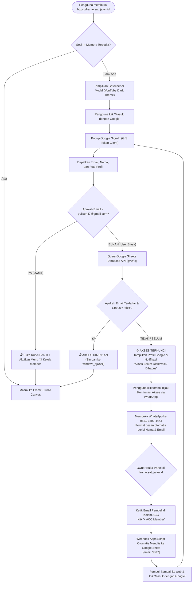
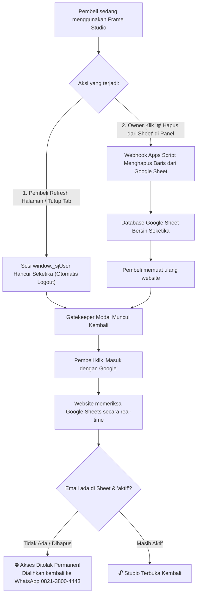

# 📘 DOKUMENTASI RESMI, ARSITEKTUR & FLOWCHART SISTEM SAAS FRAME STUDIO

Dokumen ini merupakan panduan teknis dan operasional komprehensif untuk **Frame Studio** (`[ Frame ]`), platform SaaS video kinetic motion canvas browser-based dengan autentikasi Google Sign-In, sistem lisensi whitelist real-time, dan otomasi database **Google Sheets via Webhook Apps Script Engine**.

---

## 📌 1. Identitas Resmi Proyek & Aset

| Parameter | Nilai / Konfigurasi Resmi | Keterangan / Status |
| :--- | :--- | :--- |
| **Nama Aplikasi / Brand** | **Frame Studio** (`[ Frame ]`) | Rebranding bertema YouTube Studio Dark Aesthetic |
| **Domain Utama (Produksi)** | `https://frame.satujalan.id` | Live SSL 100% Aktif via Cloudflare CNAME Vercel |
| **URL Alternatif Vercel** | `https://sj-frame-ydff.vercel.app` | Jalur langsung Vercel Edge Network (Singapore `sin1`) |
| **Repository GitHub** | `https://github.com/yopisonhaji/sj-frame` | Auto-deploy ke Vercel setiap file `index.html` di-push |
| **Google Cloud Client ID** | `781988338486-i2i2mr490bp91r3hhck1e7jph3ccjo5n.apps.googleusercontent.com` | Mode **In Production** (Semua akun Gmail bisa login) |
| **Superadmin (Owner)** | **`yulison47@gmail.com`** | Akses bypass permanen + panel kelola member di studio |
| **Nomor WhatsApp Owner** | **`082138004443`** (`+62 821-3800-4443`) | Nomor tujuan konfirmasi & ACC member baru |
| **Database Google Sheet** | [Buka Google Sheets Member](https://docs.google.com/spreadsheets/d/1wnRppGqNZ44Erwy-mBWKeoCPyvWSeYR-1xQFiVTc-Ok/edit?gid=0#gid=0) | ID: `1wnRppGqNZ44Erwy-mBWKeoCPyvWSeYR-1xQFiVTc-Ok` *(Paten & Terkunci)* |
| **Webhook Auto-Save** | `https://script.google.com/macros/s/AKfycby1vuG-mLuyNBS270jK-uMP4bY09gqJXA8D-fOg9PPcEIBa31934T5IS6OAoNeuyb1H/exec` | **Aktif 100% (Versi 3 - Siapa Saja / Anyone)** |
| **Link Gemini Sutradara AI** | [Gemini AI Video Director Shared Link](https://gemini.google.com/share/c5b85080d7a6?social_preview=false&skid=9b3c5111-1236-4bcb-871a-9b55c8052d78) | Prompt generator skrip & storyline untuk pembeli |

---

## 🧭 2. Flowchart Alur Pendaftaran, ACC, & Akses User

Diagram alur berikut mengilustrasikan perjalanan seorang pembeli mulai dari pertama kali membuka website, verifikasi akun Google, penolakan jika belum di-ACC, proses konfirmasi via WhatsApp, ACC otomatis ke Google Sheets oleh Anda, hingga masuk ke studio canvas:



---

## 🚫 3. Flowchart Pencabutan Akses (Revoke) & Auto-Logout

Sistem dirancang dengan kebijakan keamanan **In-Memory Authentication** (keamanan tinggi tanpa penyimpanan cookie berbahaya), memastikan lisensi Anda tidak disalahgunakan atau dibagikan sembarangan:



---

## 🛡️ 4. Diagram Arsitektur Keamanan & Database

```mermaid
graph LR
    subgraph ClientBrowser["Client Browser (Device Pembeli)"]
        App["Frame Studio Canvas UI"]
        GIS["Google Sign-In GIS"]
        MemoryAuth["In-Memory Auth (window._sjUser)"]
    end

    subgraph GoogleCloud["Google Cloud & Services"]
        OAuth["OAuth 2.0 Client (chatbotai-28543)"]
        GSheet["Google Sheet Database (Read via GViz)"]
        AppsScript["Apps Script Webhook (Write/Delete)"]
    end

    subgraph HostingInfrastructure["Hosting & DNS"]
        Vercel["Vercel Edge Network (sin1)"]
        Cloudflare["Cloudflare DNS (DNS-Only CNAME)"]
    end

    App -->|Otentikasi| GIS
    GIS -->|Validasi Akun| OAuth
    App -->|Query Whitelist (Read-Only)| GSheet
    AppsScript -->|Menambah / Menghapus Baris| GSheet
    Cloudflare -->|Routing CNAME| Vercel
    Vercel -->|Serve HTML/JS| App
```

---

## ✨ 5. Rincian Fitur yang Sudah 100% Selesai Dikerjakan

1. **Auto-Masuk ke Google Sheet Sekali Klik:**
   * Cukup ketik email pembeli di panel owner ➔ Klik **`+ ACC Member`**.
   * Webhook Versi 3 (`AKfycby1vuG...`) langsung menuliskan email dengan status `aktif` ke Google Sheet dalam 1 detik tanpa Anda harus membuka tab spreadsheet manual.
2. **Auto-Hapus dari Google Sheet Sekali Klik:**
   * Di setiap baris tabel daftar member, ada tombol merah **`🗑️ Hapus dari Sheet`**.
   * Sekali klik, baris pengguna tersebut langsung terhapus otomatis dari Google Sheet dan hak akses pengguna langsung mati total.
3. **Tombol Hijau Langsung ke Google Sheet (Dikunci Paten):**
   * Tombol hijau **`📊 Buka Google Sheet (Cek Memastikan / Edit)`** tepat di bawah kolom ACC sudah dikunci mati (*hardcoded*) ke alamat:  
     👉 `https://docs.google.com/spreadsheets/d/1wnRppGqNZ44Erwy-mBWKeoCPyvWSeYR-1xQFiVTc-Ok/edit?gid=0#gid=0`
   * Dilengkapi sistem pembersih otomatis (*auto-purge*) pada memori browser agar tombol dijamin 100% selalu membuka spreadsheet resmi Anda tanpa error "file tidak ada".
4. **YouTube Studio Dark Mode Aesthetic:**
   * Latar belakang obsidian dark `#0F0F0F` dengan kartu abu-abu gelap `#161618`.
   * Border halus `#27272A` dan aksen merah menyala `#FF0033`.
   * Logo wordmark `[ Frame ]` dengan bracket sudut viewfinder kamera menyala merah.
5. **Autentikasi Google GIS Murni & Aman:**
   * Menggunakan Google Identity Services Token Client resmi Google (`google.accounts.oauth2`).
   * Bebas rekursi call stack, responsif untuk browser desktop dan HP Android/iOS.
6. **Integrasi Prompt Sutradara AI Gemini:**
   * Tombol Sutradara AI terhubung ke link shared prompt Google Gemini yang sudah Anda siapkan (`gemini.google.com/share/c5b85080d7a6...`).
   * Pembeli membuka link tersebut dalam mode baca/fork sehingga prompt master Anda tetap aman dan tidak bisa diubah oleh pembeli.

---

## 📋 6. Panduan Praktis Owner (SOP Harian 5 Detik)

### A. Cara Meng-ACC Pembeli Baru
1. Pembeli menghubungi Anda di WhatsApp (`082138004443`) setelah menyelesaikan transaksi.
2. Buka [https://frame.satujalan.id](https://frame.satujalan.id) di HP atau laptop Anda.
3. Login dengan akun Owner: **`yulison47@gmail.com`**.
4. Klik tombol **`⚙️ Kelola Member`** di pojok kanan atas.
5. Ketik email Gmail pembeli pada kolom input ➔ klik **`+ ACC Member`**.
6. **Selesai!** Email otomatis tertulis di Google Sheet Anda. Pembeli langsung bisa login ke studio.

### B. Cara Menghapus / Memblokir Pembeli
1. Buka menu **`⚙️ Kelola Member`** di website.
2. Cari email pembeli pada daftar tabel member di bawah.
3. Klik tombol merah **`🗑️ Hapus dari Sheet`**.
4. **Selesai!** Baris di Google Sheet langsung terhapus otomatis, dan pembeli tidak bisa masuk lagi.

---

## 🔧 7. Riwayat Masalah & Solusi Teknis (Knowledge Base)

1. **Masalah Akses Google Sheet Awal (Status Restricted):**
   * *Penyebab:* Google Sheet baru dibuat berstatus "Dibatasi", sehingga pembacaan via API gviz terblokir login Google.
   * *Solusi:* Akses diubah menjadi "Siapa saja yang memiliki link" (*Anyone with the link*) sebagai "Pelihat" (*Viewer*).
2. **Masalah Izin Akses Webhook (Status Hanya Saya):**
   * *Penyebab:* Webhook awal diset ke "Hanya saya", sehingga Google memblokir pemanggilan API luar.
   * *Solusi:* Webhook diperbarui ke Versi 3 dengan akses "Siapa saja" (*Anyone*).
3. **Masalah Tombol Hijau Sempat Muncul "File Tidak Ada":**
   * *Penyebab:* ID Webhook sempat tersimpan di memori browser (*localStorage*) pada kolom pengaturan sheet, sehingga tautan mencoba membuka ID Webhook sebagai sheet.
   * *Solusi:* Tautan dikunci paten (*hardcoded*) ke `https://docs.google.com/spreadsheets/d/1wnRppGqNZ44Erwy-mBWKeoCPyvWSeYR-1xQFiVTc-Ok/edit?gid=0#gid=0` dan ditambahkan fungsi auto-purge memori browser.

---

## 🚀 8. Prosedur Deploy Update ke GitHub & Vercel

Seluruh kode program di [index.html](file:///d:/SJ%20MOTION/index.html) sudah siap dan telah ditanamkan Webhook Versi 3 terverifikasi serta perbaikan tautan paten.

Untuk memperbarui website live di [frame.satujalan.id](https://frame.satujalan.id):
1. Buka browser ke: 👉 **[github.com/yopisonhaji/sj-frame](https://github.com/yopisonhaji/sj-frame)**
2. Klik **Add file** ➔ **Upload files**.
3. Tarik (*drag & drop*) file **[index.html](file:///d:/SJ%20MOTION/index.html)** dari folder `D:\SJ MOTION` ke halaman GitHub tersebut.
4. Klik tombol hijau **Commit changes**.
5. Vercel akan otomatis memperbarui website dalam waktu kurang dari 20 detik!
