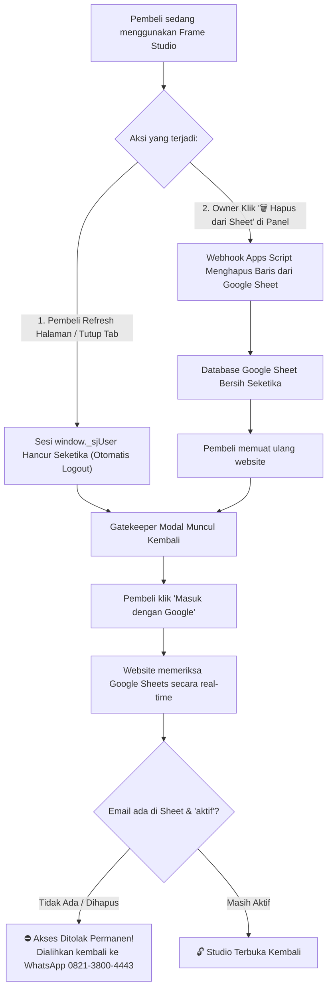

# 📘 DOKUMENTASI LENGKAP & FLOWCHART SISTEM SAAS FRAME STUDIO

Dokumen ini merupakan panduan teknis dan operasional resmi sistem **Frame Studio** (`[ Frame ]`), platform SaaS web kinetic motion video eksklusif berbasis canvas browser dengan autentikasi Google Sign-In, sistem lisensi whitelist real-time, dan otomasi database **Google Sheets via Webhook Apps Script**.

---

## 📌 1. Identitas Lengkap Proyek & Database

| Komponen | Konfigurasi / URL Resmi | Catatan |
| :--- | :--- | :--- |
| **Nama Aplikasi** | **Frame Studio** (`[ Frame ]`) | Rebranding bergaya YouTube Studio Dark Aesthetic |
| **Domain Utama** | `https://frame.satujalan.id` | Live SSL 100% Aktif via Cloudflare CNAME Vercel |
| **URL Alternatif** | `https://sj-frame-ydff.vercel.app` | Jalur langsung Vercel Edge Network (Singapore `sin1`) |
| **Repository GitHub** | `https://github.com/yopisonhaji/sj-frame` | Auto-deploy ke Vercel saat file `index.html` di-push |
| **Google Cloud Client ID** | `781988338486-i2i2mr490bp91r3hhck1e7jph3ccjo5n.apps.googleusercontent.com` | Mode **In Production** (Semua akun Gmail bisa login) |
| **Superadmin (Owner)** | **`yulison47@gmail.com`** | Akses bypass permanen + panel kelola member di studio |
| **Nomor WhatsApp Owner** | **`082138004443`** (`+62 821-3800-4443`) | Tujuan konfirmasi & ACC member baru |
| **Link Database Member** | [Buka Google Sheets Member](https://docs.google.com/spreadsheets/d/1wnRppGqNZ44Erwy-mBWKeoCPyvWSeYR-1xQFiVTc-Ok/edit?gid=0#gid=0) | ID: `1wnRppGqNZ44Erwy-mBWKeoCPyvWSeYR-1xQFiVTc-Ok` |
| **Webhook Auto-Save** | `https://script.google.com/macros/s/AKfycby1vuG-mLuyNBS270jK-uMP4bY09gqJXA8D-fOg9PPcEIBa31934T5IS6OAoNeuyb1H/exec` | **Aktif 100% (Versi 3 - Siapa Saja)** |
| **Link Gemini Sutradara AI** | [Gemini AI Video Director Shared Link](https://gemini.google.com/share/c5b85080d7a6?social_preview=false&skid=9b3c5111-1236-4bcb-871a-9b55c8052d78) | Prompt generator skrip & storyline untuk pembeli |

---

## 🧭 2. Flowchart Lengkap: Alur Pendaftaran, ACC, & Akses User

Diagram alur berikut mengilustrasikan perjalanan seorang pembeli mulai dari pertama kali membuka website, verifikasi Google, penolakan jika belum di-ACC, proses konfirmasi via WhatsApp, ACC otomatis ke Google Sheets oleh Anda, hingga hak akses dicabut:

---

## 🚫 3. Flowchart Lengkap: Alur Pencabutan Akses (Revoke) & Auto-Logout

Sistem dirancang dengan kebijakan keamanan **In-Memory Authentication** (keamanan tinggi tanpa penyimpanan cookie berbahaya), memastikan lisensi Anda tidak disalahgunakan atau dibagikan sembarangan:

---

## ⚡ 4. Rincian Fitur yang Sudah 100% Selesai Dikerjakan

1. **Auto-Masuk ke Google Sheet (Sekali Klik):**
   * Masukkan email Gmail pembeli di panel owner ➔ Klik **`+ ACC Member`**.
   * Webhook otomatis menuliskan `[email, 'aktif']` ke Google Sheet Anda dalam 1 detik tanpa perlu membuka spreadsheet manual.
2. **Auto-Hapus dari Google Sheet (Sekali Klik):**
   * Pada tabel daftar pengguna di panel owner, setiap akun memiliki tombol merah **`🗑️ Hapus dari Sheet`**.
   * Sekali klik, baris pengguna tersebut langsung terhapus dari Google Sheet dan aksesnya seketika dicabut.
3. **Tombol Cek Langsung Tepat di Bawah Kolom ACC:**
   * Tombol hijau: **`📊 Buka Google Sheet (Cek Memastikan / Edit)`** yang langsung membuka spreadsheet `1wnRppGqNZ44Erwy-mBWKeoCPyvWSeYR-1xQFiVTc-Ok`.
   * Tombol: **`🔄 Sync / Refresh Tabel`** untuk menyegarkan daftar secara instan.
4. **YouTube Studio Dark Mode Aesthetic:**
   * Latar belakang obsidian dark `#0F0F0F` dengan kartu abu-abu gelap `#161618`.
   * Border halus `#27272A` dan aksen merah menyala `#FF0033`.
   * Logo wordmark `[ Frame ]` dengan bracket viewfinder kamera menyala merah.
5. **Autentikasi Google GIS Murni & Aman:**
   * Menggunakan Google Identity Services (GIS) Token Client resmi Google.
   * Bebas popup error, bebas rekursi, dan mendukung Google Chrome, Edge, Safari, serta perangkat HP Android/iOS.
6. **Integrasi Prompt Sutradara AI Gemini:**
   * Tombol Sutradara AI terhubung ke link shared prompt Google Gemini yang sudah Anda siapkan (`gemini.google.com/share/c5b85080d7a6...`).
   * Pembeli membuka link tersebut dalam mode baca/fork sehingga prompt master Anda tetap aman dan tidak bisa diubah oleh pembeli.

---

## 📋 5. Panduan Praktis Owner (SOP Harian 5 Detik)

### A. Cara Meng-ACC Pembeli Baru
1. Pembeli menghubungi Anda di WhatsApp (`082138004443`) setelah menyelesaikan transaksi.
2. Buka [https://frame.satujalan.id](https://frame.satujalan.id) di HP atau laptop Anda.
3. Login dengan akun Owner: **`yulison47@gmail.com`**.
4. Klik tombol **`⚙️ Kelola Member`** di pojok kanan atas.
5. Ketik email Gmail pembeli pada kolom input ➔ klik **`+ ACC Member`**.
6. **Selesai!** Email otomatis tertulis di Google Sheet Anda. Pembeli langsung bisa login ke studio.

### B. Cara Menghapus / Memblokir Pembeli
1. Buka menu **`⚙️ Kelola Member`** di website.
2. Cari email pembeli pada daftar tabel member di bawah.
3. Klik tombol merah **`🗑️ Hapus dari Sheet`**.
4. **Selesai!** Baris di Google Sheet langsung terhapus otomatis, dan pembeli tidak bisa masuk lagi.

---

## 🚀 6. Prosedur Deploy Update ke GitHub & Vercel

Seluruh kode program di [index.html](file:///d:/SJ%20MOTION/index.html) sudah siap dan telah ditanamkan Webhook Versi 3 terverifikasi.

Untuk memperbarui website live di [frame.satujalan.id](https://frame.satujalan.id):
1. Buka browser ke: 👉 **[github.com/yopisonhaji/sj-frame](https://github.com/yopisonhaji/sj-frame)**
2. Klik **Add file** ➔ **Upload files**.
3. Tarik (*drag & drop*) file **[index.html](file:///d:/SJ%20MOTION/index.html)** dari folder `D:\SJ MOTION` ke halaman GitHub tersebut.
4. Klik tombol hijau **Commit changes**.
5. Vercel akan otomatis memperbarui website dalam waktu kurang dari 20 detik!
