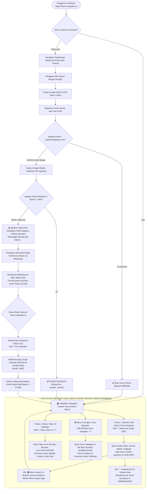

# 📘 DOKUMENTASI RESMI, ARSITEKTUR & FLOWCHART SISTEM SAAS FRAME STUDIO

Dokumen ini merupakan panduan teknis dan operasional komprehensif untuk **Frame Studio** (`[ Frame ]`), platform SaaS video kinetic motion canvas browser-based dengan autentikasi Google Sign-In, sistem lisensi whitelist real-time, **Portal 3-Menu Pasca-Login (Satujalan Creator Hub)** dengan sistem **Tri-Color Visual Distinction** (Merah, Biru, Ungu), kebijakan **100% White-Label Satujalan Brand**, dan otomasi database **Google Sheets via Webhook Apps Script Engine**.

---

## 📌 1. Identitas Resmi Proyek & Aset

| Parameter | Nilai / Konfigurasi Resmi | Keterangan / Status |
| :--- | :--- | :--- |
| **Nama Aplikasi / Brand** | **Frame Studio** (`[ Frame ]`) | Rebranding bertema YouTube Studio Dark Aesthetic |
| **Domain Utama (Produksi)** | `https://frame.satujalan.id` | Live SSL 100% Aktif via Cloudflare CNAME Vercel |
| **URL Alternatif Vercel** | `https://sj-frame-ydff.vercel.app` | Jalur langsung Vercel Edge Network (Singapore `sin1`) |
| **Repository GitHub** | `https://github.com/yopisonhaji/sj-frame` | Auto-deploy ke Vercel setiap file `index.html` di-push |
| **Google Cloud Client ID** | `781988338486-i2i2mr490bp91r3hhck1e7jph3ccjo5n.apps.googleusercontent.com` | Mode **In Production** (Semua akun Gmail bisa login) |
| **Superadmin (Owner)** | **`yulison47@gmail.com`** | Akses bypass permanen + panel kelola member di studio |
| **Nomor WhatsApp Owner** | **`082138004443`** (`+62 821-3800-4443`) | Nomor tujuan konfirmasi & ACC member baru |
| **Database Google Sheet** | [Buka Google Sheets Member](https://docs.google.com/spreadsheets/d/1wnRppGqNZ44Erwy-mBWKeoCPyvWSeYR-1xQFiVTc-Ok/edit?gid=0#gid=0) | ID: `1wnRppGqNZ44Erwy-mBWKeoCPyvWSeYR-1xQFiVTc-Ok` *(Paten & Terkunci)* |
| **Webhook Auto-Save** | `https://script.google.com/macros/s/AKfycby1vuG-mLuyNBS270jK-uMP4bY09gqJXA8D-fOg9PPcEIBa31934T5IS6OAoNeuyb1H/exec` | **Aktif 100% (Versi 3 - Siapa Saja / Anyone)** |
| **Menu 1 (Studio)** | **Edit Video Frame Satujalan** 🔴 *Merah Studio (`#FF0033`)* | Generator video kinetic motion & typography browser |
| **Menu 2 (Cliper AI)** | [Cliper AI Satujalan](https://share.gemini.google/sOxX4GYQAOOR) 🔵 *Biru Elektrik (`#2563EB`)* | Link resmi Cliper: `https://share.gemini.google/sOxX4GYQAOOR` *(White-Label)* |
| **Menu 3 (Voice Dubbing)**| [Voice Satujalan](https://gemini.google.com/share/ec689ac3cd26) 🟣 *Ungu Violet (`#8B5CF6`)* | Link resmi Voice: `https://gemini.google.com/share/ec689ac3cd26` *(White-Label)* |
| **Header Nav (Sutradara)**| [Sutradara AI](https://gemini.google.com/share/658bbd2ad0b7?social_preview=false&skid=43585bc7-a891-43a6-9aa0-a9292084f7bb) 🔵 *Biru Elektrik (`#2563EB`)* | Link resmi Sutradara AI: `https://gemini.google.com/share/658bbd2ad0b7...` |

---

## 🧭 2. Flowchart Alur Pendaftaran, ACC, & Akses 3 Menu Satujalan

Diagram alur berikut mengilustrasikan perjalanan seorang pembeli mulai dari login Google, validasi status ACC, hingga masuk ke **Portal 3 Menu Utama Satujalan**:



---

## 🛡️ 3. Diagram Arsitektur Keamanan & Database

```mermaid
graph LR
    subgraph Frontend ["Client Browser (frame.satujalan.id)"]
        App["Frame Studio App"]
        GIS["Google Identity Services (GIS)"]
        Hub["Satujalan Creator Hub (3 Menu)"]
    end

    subgraph GoogleCloud ["Google Ecosystem"]
        OAuth["Google OAuth 2.0 Auth Server"]
        GSheet[("Google Sheets Database<br/>(Member Whitelist)")]
        AppsScript["Google Apps Script Webhook<br/>(AKfycby1vuG...)"]
        SutradaraAI["AI Sutradara Satujalan<br/>(658bbd2ad0b7)"]
        CliperAI["AI Cliper Satujalan<br/>(sOxX4GYQAOOR)"]
        VoiceAI["AI Voice Satujalan<br/>(ec689ac3cd26)"]
    end

    subgraph Hosting ["Vercel Edge Network"]
        Vercel["Production Deployment (sin1)"]
        Cloudflare["Cloudflare DNS (DNS-Only CNAME)"]
    end

    App -->|Otentikasi| GIS
    GIS -->|Validasi Akun| OAuth
    App -->|Query Whitelist (Read-Only)| GSheet
    AppsScript -->|Menambah / Menghapus Baris| GSheet
    Cloudflare -->|Routing CNAME| Vercel
    Vercel -->|Serve HTML/JS| App
    Hub -->|Akses Studio| App
    Hub -->|Card 2: Direct Link (Biru)| CliperAI
    Hub -->|Card 3: Direct Link (Ungu)| VoiceAI
    App -->|Header Button: Direct Link| SutradaraAI
```

---

## ✨ 4. Rincian Fitur & Tri-Color Visual Distinction

### 1. Portal 3-Menu Pasca-Login (Satujalan Creator Hub)
Setelah pengguna berhasil login dengan Google (atau setelah pembeli baru di-ACC oleh Owner):
Sistem menyambut pengguna dengan **Satujalan Creator Hub** yang elegan bertema Obsidian Dark `#0F0F0F` dengan **3 Menu Berwarna Berbeda** agar sangat mudah dihafal:

* **Menu 1: 🔴 Edit Video Frame Satujalan (Merah Studio `#FF0033` / `#CC0000`)**
  * Badge: `● STUDIO VIDEO MOTION AI`
  * Tombol: `🚀 Masuk ke Studio Edit`.
  * Membuka studio pembuat video motion graphics, kinetic typography, b-roll AI, auto punch-in zoom, transisi sinematik, efek suara, dan render MP4 langsung di browser.
* **Menu 2: 🔵 Cliper AI Satujalan (Biru Elektrik `#2563EB` / `#1D4ED8`)**
  * Badge: `● AI CLIPER & KONTEN`
  * Tombol: `⚡ Buka Cliper AI ↗`.
  * Tautan resmi Cliper: 👉 `https://share.gemini.google/sOxX4GYQAOOR`
  * Asisten cliper AI cerdas untuk meracik konsep cerita, copywriting naskah hook tajam, arahan visual, dan strategi klip konten bertenaga AI Satujalan Suite.
  * **White-Label:** Teks kartu: *"Langsung Siap Pakai di Tab Baru Browser"*.
* **Menu 3: 🟣 Voice Satujalan (Ungu Violet Elektrik `#8B5CF6` / `#6D28D9`)**
  * Badge: `● AI VOICE & DUBBING ENGINE`
  * Tombol: `🎙️ Buka Voice Satujalan ↗`.
  * Tautan resmi Voice: 👉 `https://gemini.google.com/share/ec689ac3cd26`
  * Studio narasi suara AI cerdas untuk meracik voiceover alami berkualitas rekaman studio, intonasi emosional, dan dubbing audio bertenaga AI Satujalan Suite.
  * **White-Label:** Teks kartu: *"Text-to-Speech & Voiceover Alami Super Realistis"* dan *"Langsung Siap Pakai di Tab Baru Browser"*.

### 2. Navigasi Header Terintegrasi (Bar Atas Studio):
Ketika masuk ke dalam ruang kerja Studio Video, bar navigasi atas menyediakan akses instan yang ringkas dan bersih:
* Tombol **`🏠 Menu Utama`**: Beralih kembali ke portal 3 menu kapan saja.
* Tombol **`✨ Sutradara AI`** *(Biru Elektrik `#2563EB`)*: Membuka Sutradara AI resmi dalam 1 klik dari bar atas ke:  
  👉 `https://gemini.google.com/share/658bbd2ad0b7?social_preview=false&skid=43585bc7-a891-43a6-9aa0-a9292084f7bb`
* Tombol **`⚙️ Kelola Member`**: Panel admin khusus Owner (`yulison47@gmail.com`).
* Tombol **`Keluar`**: Keluar dari sesi dan mengunci aplikasi.

### 3. Kebijakan White-Label Satujalan:
* Seluruh teks antarmuka, modal, tooltip, dan badge tidak menyebutkan nama Google Gemini ("sya tdk mau orang tau kalau ini gemini").
* Hak cipta resmi: `© 2026 Satujalan.id`.

### 4. Auto-Masuk & Auto-Hapus Google Sheet Sekali Klik:
* Cukup ketik email pembeli di panel owner ➔ Klik **`+ ACC Member`**. Webhook Versi 3 (`AKfycby1vuG...`) langsung menuliskan email status `aktif` dalam 1 detik.
* Di setiap baris tabel daftar member, ada tombol merah **`🗑️ Hapus dari Sheet`** untuk mencabut akses seketika.

### 5. Tombol Hijau Langsung ke Google Sheet (Dikunci Paten):
* Tombol hijau **`📊 Buka Google Sheet (Cek Memastikan / Edit)`** dikunci mati (*hardcoded*) ke:  
  👉 `https://docs.google.com/spreadsheets/d/1wnRppGqNZ44Erwy-mBWKeoCPyvWSeYR-1xQFiVTc-Ok/edit?gid=0#gid=0`
* Dilengkapi auto-purge memori browser agar dijamin 100% selalu membuka spreadsheet resmi Anda tanpa error.

---

## 📋 5. Panduan Praktis Owner (SOP Harian 5 Detik)

### A. Cara Meng-ACC Pembeli Baru
1. Pembeli menghubungi Anda di WhatsApp (`082138004443`) setelah menyelesaikan transaksi.
2. Buka [https://frame.satujalan.id](https://frame.satujalan.id) di HP atau laptop Anda.
3. Login dengan akun Owner: **`yulison47@gmail.com`**.
4. Klik tombol **`⚙️ Kelola Member`** di bar atas.
5. Ketik email Gmail pembeli pada kolom input ➔ klik **`+ ACC Member`**.
6. **Selesai!** Email otomatis tertulis di Google Sheet Anda. Pembeli akan otomatis masuk ke **Hub 3 Pilihan Menu** secara instan!

### B. Cara Menghapus / Memblokir Pembeli
1. Buka menu **`⚙️ Kelola Member`** di website.
2. Cari email pembeli pada daftar tabel member di bawah.
3. Klik tombol merah **`🗑️ Hapus dari Sheet`**.
4. **Selesai!** Baris di Google Sheet langsung terhapus otomatis, dan pembeli tidak bisa masuk lagi.

---

## 🚀 6. Prosedur Deploy Update ke GitHub & Vercel

Seluruh kode program di [index.html](file:///d:/SJ%20MOTION/index.html) sudah siap dan telah ditanamkan pemisahan link yang tepat: Sutradara AI di header (link 658bbd2ad0b7) dan Cliper AI di Hub Card 2 (link sOxX4GYQAOOR).

Untuk memperbarui website live di [frame.satujalan.id](https://frame.satujalan.id):
1. Buka browser ke: 👉 **[github.com/yopisonhaji/sj-frame](https://github.com/yopisonhaji/sj-frame)**
2. Klik **Add file** ➔ **Upload files**.
3. Tarik (*drag & drop*) file **[index.html](file:///d:/SJ%20MOTION/index.html)** dari folder `D:\SJ MOTION` ke halaman GitHub tersebut.
4. Klik tombol hijau **Commit changes**.
5. Vercel akan otomatis memperbarui website dalam waktu kurang dari 20 detik!
