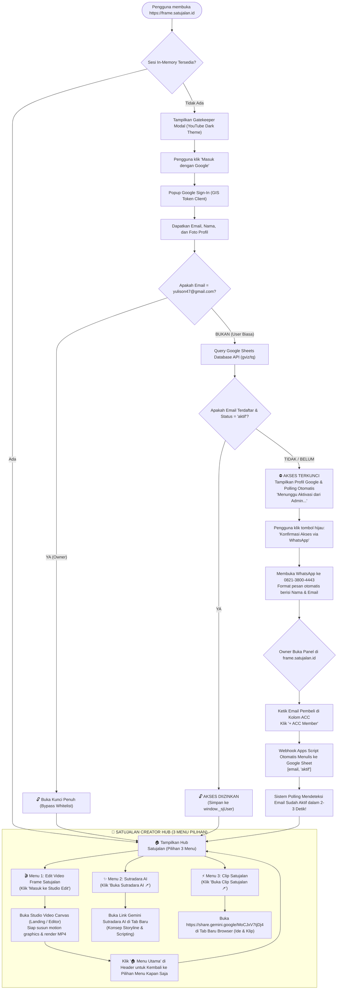
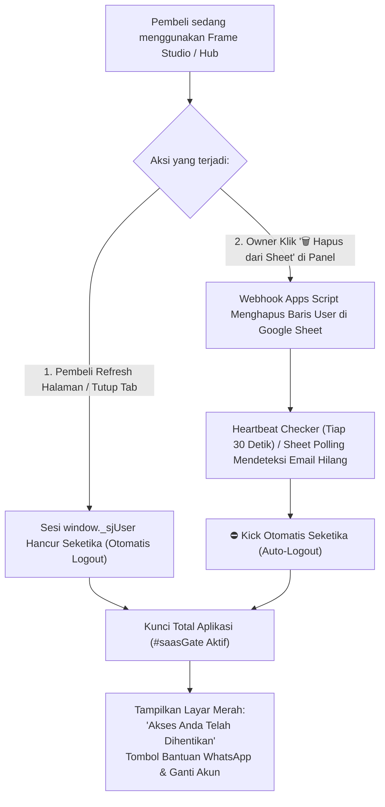

# 📘 DOKUMENTASI RESMI, ARSITEKTUR & FLOWCHART SISTEM SAAS FRAME STUDIO

Dokumen ini merupakan panduan teknis dan operasional komprehensif untuk **Frame Studio** (`[ Frame ]`), platform SaaS video kinetic motion canvas browser-based dengan autentikasi Google Sign-In, sistem lisensi whitelist real-time, **Portal 3-Menu Pasca-Login (Satujalan Creator Hub)**, dan otomasi database **Google Sheets via Webhook Apps Script Engine**.

---

## 📌 1. Identitas Resmi Proyek & Aset

| Parameter | Nilai / Konfigurasi Resmi | Keterangan / Status |
| :--- | :--- | :--- |
| **Nama Aplikasi / Brand** | **Frame Studio** (`[ Frame ]`) | Rebranding bertema YouTube Studio Dark Aesthetic |
| **Domain Utama (Produksi)** | `https://frame.satujalan.id` | Live SSL 100% Aktif via Cloudflare CNAME Vercel |
| **URL Alternatif Vercel** | `https://sj-frame-ydff.vercel.app` | Jalur langsung Vercel Edge Network (Singapore `sin1`) |
| **Repository GitHub** | `https://github.com/yopisonhaji/sj-frame` | Auto-deploy ke Vercel setiap file `index.html` di-push |
| **Google Cloud Client ID** | `781988338486-i2i2mr490bp91r3hhck1e7jph3ccjo5n.apps.googleusercontent.com` | Mode **In Production** (Semua akun Gmail bisa login) |
| **Superadmin (Owner)** | **`yulison47@gmail.com`** | Akses bypass permanen + panel kelola member di studio |
| **Nomor WhatsApp Owner** | **`082138004443`** (`+62 821-3800-4443`) | Nomor tujuan konfirmasi & ACC member baru |
| **Database Google Sheet** | [Buka Google Sheets Member](https://docs.google.com/spreadsheets/d/1wnRppGqNZ44Erwy-mBWKeoCPyvWSeYR-1xQFiVTc-Ok/edit?gid=0#gid=0) | ID: `1wnRppGqNZ44Erwy-mBWKeoCPyvWSeYR-1xQFiVTc-Ok` *(Paten & Terkunci)* |
| **Webhook Auto-Save** | `https://script.google.com/macros/s/AKfycby1vuG-mLuyNBS270jK-uMP4bY09gqJXA8D-fOg9PPcEIBa31934T5IS6OAoNeuyb1H/exec` | **Aktif 100% (Versi 3 - Siapa Saja / Anyone)** |
| **Menu 1 (Studio)** | **Edit Video Frame Satujalan** | Generator video kinetic motion & typography browser |
| **Menu 2 (Sutradara AI)** | [Sutradara AI (Gemini AI)](https://gemini.google.com/share/c5b85080d7a6?social_preview=false&skid=9b3c5111-1236-4bcb-871a-9b55c8052d78) | Link resmi: `https://gemini.google.com/share/c5b85080d7a6...` |
| **Menu 3 (Clipper AI)** | [Clip Satujalan (Gemini AI)](https://share.gemini.google/MoCJxV7tjDj4) | Link resmi: `https://share.gemini.google/MoCJxV7tjDj4` |

---

## 🧭 2. Flowchart Alur Pendaftaran, ACC, & Akses 3 Menu Satujalan

Diagram alur berikut mengilustrasikan perjalanan seorang pembeli mulai dari login Google, validasi status ACC, hingga masuk ke **Portal 3 Menu Utama**:



---

## 🚫 3. Flowchart Pencabutan Akses (Revoke) & Auto-Logout

Sistem dirancang dengan kebijakan keamanan **In-Memory Authentication** (keamanan tinggi tanpa penyimpanan cookie berbahaya), memastikan lisensi Anda tidak disalahgunakan atau dibagikan sembarangan:



---

## 🛡️ 4. Diagram Arsitektur Keamanan & Database

```mermaid
graph LR
    subgraph Frontend ["Client Browser (frame.satujalan.id)"]
        App["Frame Studio App"]
        GIS["Google Identity Services (GIS)"]
        Hub["Satujalan Creator Hub (3 Menu)"]
    end

    subgraph GoogleCloud ["Google Ecosystem"]
        OAuth["Google OAuth 2.0 Auth Server"]
        GSheet[("Google Sheets Database<br/>(Member Whitelist)")]
        AppsScript["Google Apps Script Webhook<br/>(AKfycby1vuG...)"]
        GeminiSutradara["Gemini Sutradara AI<br/>(gemini.google.com/share/...)"]
        GeminiClip["Gemini AI Clip Satujalan<br/>(share.gemini.google/MoCJx...)"]
    end

    subgraph Hosting ["Vercel Edge Network"]
        Vercel["Production Deployment (sin1)"]
        Cloudflare["Cloudflare DNS (DNS-Only CNAME)"]
    end

    App -->|Otentikasi| GIS
    GIS -->|Validasi Akun| OAuth
    App -->|Query Whitelist (Read-Only)| GSheet
    AppsScript -->|Menambah / Menghapus Baris| GSheet
    Cloudflare -->|Routing CNAME| Vercel
    Vercel -->|Serve HTML/JS| App
    Hub -->|Akses Studio| App
    Hub -->|Direct Link| GeminiSutradara
    Hub -->|Direct Link| GeminiClip
```

---

## ✨ 5. Rincian Fitur yang Sudah 100% Selesai Dikerjakan

### 1. Portal 3-Menu Pasca-Login (Satujalan Creator Hub)
Setelah pengguna berhasil login dengan Google (atau setelah pembeli baru di-ACC oleh Owner):
Sistem menyambut pengguna dengan **Satujalan Creator Hub** yang elegan bertema Obsidian Dark:
* **Menu 1: 🎬 Edit Video Frame Satujalan**
  * Tombol: `🚀 Masuk ke Studio Edit`.
  * Membuka studio pembuat video motion graphics, kinetic typography, b-roll AI, auto punch-in zoom, transisi sinematik, efek suara, dan render MP4 langsung di browser.
* **Menu 2: ✨ Sutradara AI Satujalan**
  * Tombol: `✨ Buka Sutradara AI ↗`.
  * Tautan resmi: 👉 `https://gemini.google.com/share/c5b85080d7a6?social_preview=false&skid=9b3c5111-1236-4bcb-871a-9b55c8052d78`
  * Asisten sutradara AI eksklusif untuk merancang konsep alur cerita, arahan visual, copywriting naskah, dan formula hook pembuka video.
* **Menu 3: ⚡ Clip Satujalan**
  * Tombol: `⚡ Buka Clip Satujalan ↗`.
  * Tautan resmi: 👉 `https://share.gemini.google/MoCJxV7tjDj4`
  * Asisten AI cerdas untuk meracik ide viral, kurasi materi konten, dan strategi pemotongan klip video bertenaga Gemini AI.

### 2. Navigasi Header Terintegrasi:
* Tombol **`🏠 Menu Utama`**: Beralih kembali ke portal 3 menu kapan saja tanpa kehilangan draf.
* Tombol **`✨ Sutradara AI`** (Rose Red Glow): Membuka Sutradara AI dalam 1 klik dari bar atas.
* Tombol **`⚡ Clip Satujalan`** (Electric Blue Glow): Membuka Clip Satujalan dalam 1 klik dari bar atas.
* Klik pada Logo **`Frame`** di pojok kiri atas otomatis membawa pengguna kembali ke Menu Utama saat login aktif.

### 3. Auto-Masuk ke Google Sheet Sekali Klik:
* Cukup ketik email pembeli di panel owner ➔ Klik **`+ ACC Member`**.
* Webhook Versi 3 (`AKfycby1vuG...`) langsung menuliskan email dengan status `aktif` ke Google Sheet dalam 1 detik tanpa Anda harus membuka tab spreadsheet manual.

### 4. Auto-Hapus dari Google Sheet Sekali Klik:
* Di setiap baris tabel daftar member, ada tombol merah **`🗑️ Hapus dari Sheet`**.
* Sekali klik, baris pengguna tersebut langsung terhapus otomatis dari Google Sheet dan hak akses pengguna langsung mati total.

### 5. Tombol Hijau Langsung ke Google Sheet (Dikunci Paten):
* Tombol hijau **`📊 Buka Google Sheet (Cek Memastikan / Edit)`** tepat di bawah kolom ACC sudah dikunci mati (*hardcoded*) ke alamat:  
  👉 `https://docs.google.com/spreadsheets/d/1wnRppGqNZ44Erwy-mBWKeoCPyvWSeYR-1xQFiVTc-Ok/edit?gid=0#gid=0`
* Dilengkapi sistem pembersih otomatis (*auto-purge*) pada memori browser agar tombol dijamin 100% selalu membuka spreadsheet resmi Anda tanpa error "file tidak ada".

### 6. YouTube Studio Dark Mode Aesthetic:
* Latar belakang obsidian dark `#0F0F0F` dengan kartu abu-abu gelap `#161618`.
* Border halus `#27272A` dan aksen merah menyala `#FF0033` untuk Video Studio, rose red `#E11D48` untuk Sutradara AI, serta biru listrik `#2563EB` untuk Clip Satujalan.
* Logo wordmark `[ Frame ]` dengan bracket sudut viewfinder kamera menyala merah.

### 7. Autentikasi Google GIS Murni & Aman:
* Menggunakan Google Identity Services Token Client resmi Google (`google.accounts.oauth2`).
* Bebas rekursi call stack, responsif untuk browser desktop dan HP Android/iOS.
* Sistem Polling otomatis memeriksa aktivasi tiap 2-3 detik saat pengguna menunggu ACC.

---

## 📋 6. Panduan Praktis Owner (SOP Harian 5 Detik)

### A. Cara Meng-ACC Pembeli Baru
1. Pembeli menghubungi Anda di WhatsApp (`082138004443`) setelah menyelesaikan transaksi.
2. Buka [https://frame.satujalan.id](https://frame.satujalan.id) di HP atau laptop Anda.
3. Login dengan akun Owner: **`yulison47@gmail.com`**.
4. Klik tombol **`⚙️ Kelola Member`** di bar atas.
5. Ketik email Gmail pembeli pada kolom input ➔ klik **`+ ACC Member`**.
6. **Selesai!** Email otomatis tertulis di Google Sheet Anda. Pembeli akan otomatis masuk ke **Hub 3 Pilihan Menu** secara instan!

### B. Cara Menghapus / Memblokir Pembeli
1. Buka menu **`⚙️ Kelola Member`** di website.
2. Cari email pembeli pada daftar tabel member di bawah.
3. Klik tombol merah **`🗑️ Hapus dari Sheet`**.
4. **Selesai!** Baris di Google Sheet langsung terhapus otomatis, dan pembeli tidak bisa masuk lagi.

---

## 🔧 7. Riwayat Masalah & Solusi Teknis (Knowledge Base)

1. **Kehadiran Menu Sutradara AI & Clip Satujalan Bersama:**
   * *Masalah:* Sebelumnya nama tombol Sutradara AI sempat diganti menjadi Clip Satujalan sehingga Sutradara AI tidak terlihat.
   * *Solusi:* Sutradara AI dan Clip Satujalan dipisahkan menjadi dua menu/tombol mandiri yang berdampingan:
     * **Sutradara AI:** Khusus konsep cerita, alur naskah & storyboard visual.
     * **Clip Satujalan:** Khusus kurasi ide viral, hook tajam & pemotongan klip video.
     * Keduanya kini hadir lengkap di layar Hub Creator maupun di bar navigasi atas.
2. **Masalah Akses Google Sheet Awal (Status Restricted):**
   * *Penyebab:* Google Sheet baru dibuat berstatus "Dibatasi", sehingga pembacaan via API gviz terblokir login Google.
   * *Solusi:* Akses diubah menjadi "Siapa saja yang memiliki link" (*Anyone with the link*) sebagai "Pelihat" (*Viewer*).
3. **Masalah Izin Akses Webhook (Status Hanya Saya):**
   * *Penyebab:* Webhook awal diset ke "Hanya saya", sehingga Google memblokir pemanggilan API luar.
   * *Solusi:* Webhook diperbarui ke Versi 3 dengan akses "Siapa saja" (*Anyone*).
4. **Masalah Tombol Hijau Sempat Muncul "File Tidak Ada":**
   * *Penyebab:* ID Webhook sempat tersimpan di memori browser (*localStorage*) pada kolom pengaturan sheet, sehingga tautan mencoba membuka ID Webhook sebagai sheet.
   * *Solusi:* Tautan dikunci paten (*hardcoded*) ke `https://docs.google.com/spreadsheets/d/1wnRppGqNZ44Erwy-mBWKeoCPyvWSeYR-1xQFiVTc-Ok/edit?gid=0#gid=0` dan ditambahkan fungsi auto-purge memori browser.

---

## 🚀 8. Prosedur Deploy Update ke GitHub & Vercel

Seluruh kode program di [index.html](file:///d:/SJ%20MOTION/index.html) sudah siap dan telah ditanamkan Hub 3 Menu, Webhook Versi 3 terverifikasi, serta tombol paten.

Untuk memperbarui website live di [frame.satujalan.id](https://frame.satujalan.id):
1. Buka browser ke: 👉 **[github.com/yopisonhaji/sj-frame](https://github.com/yopisonhaji/sj-frame)**
2. Klik **Add file** ➔ **Upload files**.
3. Tarik (*drag & drop*) file **[index.html](file:///d:/SJ%20MOTION/index.html)** dari folder `D:\SJ MOTION` ke halaman GitHub tersebut.
4. Klik tombol hijau **Commit changes**.
5. Vercel akan otomatis memperbarui website dalam waktu kurang dari 20 detik!
